# mousemap

A small macOS background tool for a regular mouse:

- **Smooth, trackpad-style scrolling** for the mouse wheel: the page follows
  the wheel one to one and, after a fast spin, coasts to a stop along the same
  curve as macOS's trackpad momentum. Apps that scroll by lines (like
  Terminal) are told about lines the way a trackpad reports them, so one speed
  feels right everywhere. In iPhone Mirroring, which animates every scroll
  event on the phone, the same movement goes out in fewer, bigger steps (15 a
  second) so the phone follows the wheel instead of jumping when it stops.
- **Reverse the mouse wheel only.** macOS has one "natural scrolling" switch
  for mouse and trackpad together; keep it on for the trackpad and flip just
  the wheel.
- **Remap the side buttons** (back / forward) and the wheel click to keyboard
  shortcuts, media keys or shell commands.
- **Per-app settings**, e.g. a different scroll speed or button action in one app.

One Swift file, no dependencies. Nothing is written to the mouse; it all
happens on the Mac through an event tap. Trackpads and Magic Mouse are left
alone.

Built for and measured with a Logitech Signature M650 on macOS 27, but it works
with any mouse that has a notched wheel. [How it works](#how-it-works) explains
the whole design, with diagrams and measurements.

## Install

Needs macOS 12 or later (tested on macOS 27) and the Swift compiler
(`xcode-select --install`).

    git clone https://github.com/Anubhav-Rai/mousemap.git
    cd mousemap
    ./install.sh

This builds it, installs it to `~/.local/bin/mousemap` (put that on your
`PATH`), and starts it now and at every login. Then allow **mousemap** in
System Settings > Privacy & Security > Device Control and Data Access (called
"Accessibility" on older macOS). It starts working within a couple of seconds.

install.sh signs the binary with a self-signed certificate it creates on first
run (kept in `.signing/`, never committed), so the permission survives
rebuilds. Delete `.signing/` and you'll have to allow it again.

To remove: `./uninstall.sh` (keeps your config in `~/.config/mousemap`).

## Use

    mousemap show                               # current settings
    mousemap set scroll_speed 1.2               # change a setting everywhere
    mousemap set Preview scroll_speed 0.5       # ...or for one app
    mousemap unset Preview scroll_speed         # back to the everywhere value
    mousemap set forward ctrl+up                # Forward button opens Mission Control
    mousemap status                             # running? config valid? recent log
    mousemap apps                               # app names and bundle IDs
    mousemap off / on                           # stop / start
    mousemap edit                               # open the config file

Changes apply immediately. Settings live in `~/.config/mousemap/config.json`,
which also documents every option.

## Settings

| Setting | Default | |
|---|---|---|
| `smooth_scroll` | `true` | smooth scrolling for the mouse wheel |
| `scroll_speed` | `1.0` | how far each notch scrolls; 2.0 = twice as far |
| `scroll_smoothness` | `1.0` | glide of each notch; 0.5 = snappier, 2.0 = floatier |
| `scroll_momentum` | `1.0` | coasting after fast scrolling; 0 = none, 2.0 = longer |
| `scroll_reverse` | `false` | flip the mouse wheel only |
| `back`, `forward`, `middle` | normal | button actions, see below |

Button actions: a shortcut like `cmd+c`, `ctrl+left`, `cmd+shift+]`, `f11`;
a media key like `media:volume_up`, `media:play_pause`; a command like
`shell:open -a Safari`; `none` to disable the button; `default` for its
normal behaviour.

Per-app settings (buttons and `scroll_*`) apply while that app is in front.

Log: `~/Library/Logs/mousemap.log`

## Known limits

Some differences from a trackpad come from the wheel itself and can't be fixed
by any Mac software. All of them were recorded from the mouse before anything
on the Mac touches its events ([details](#5-the-wheels-own-limits)):

- **Rubbing the wheel up and down very fast** only reports one direction: the
  strokes back send nothing. The page goes one way, or sits at the end of a
  short page and looks stuck. It's the same with mousemap turned off. A little
  slower, and the wheel reports both directions again.
- **Grabbing a fast-spinning wheel to turn back** sends nothing until it has
  clicked one notch the other way, about a quarter of a second later, so the
  glide carries on until then. A trackpad feels your finger land; a wheel can't.
- **Moving the pointer to another window mid-glide** stops the glide. A
  trackpad scroll stays with its window; mousemap's events can't be sent to a
  window the pointer has left.
- **Per-app settings follow the app in front** (keyboard focus), not the window
  under the pointer.
- **With cmd, ctrl, alt or shift held**, scrolling is passed through as is
  (zoom, sideways scrolling), only reversed if `scroll_reverse` is on.

---

# How it works

This part explains how trackpad scrolling works on macOS, why a mouse wheel
feels so different, and how mousemap closes the gap: first the overall design
(HLD), then every piece in detail (LLD), with the measurements behind each
decision. Every chart below comes from real recordings or from mousemap's own
code.

**Contents**

1. [How a trackpad scroll works](#1-how-a-trackpad-scroll-works)
2. [How a mouse wheel scroll works, and what goes wrong](#2-how-a-mouse-wheel-scroll-works-and-what-goes-wrong)
3. [High-level design](#3-high-level-design)
4. [Low-level design](#4-low-level-design)
   1. [The event tap](#41-the-event-tap)
   2. [Buttons](#42-buttons)
   3. [The scroll engine: the wheel as a finger](#43-the-scroll-engine-the-wheel-as-a-finger)
   4. [Posting scroll events](#44-posting-scroll-events)
   5. [Reversing the wheel only](#45-reversing-the-wheel-only)
   6. [iPhone Mirroring](#46-iphone-mirroring)
   7. [Staying with one window](#47-staying-with-one-window)
   8. [Config and commands](#48-config-and-commands)
   9. [Running in the background](#49-running-in-the-background)
5. [The wheel's own limits](#5-the-wheels-own-limits)
6. [Design decisions and what was tried](#6-design-decisions-and-what-was-tried)
7. [How it was measured](#7-how-it-was-measured)
8. [Numbers at a glance](#8-numbers-at-a-glance)
9. [Code map](#9-code-map)

## 1. How a trackpad scroll works

A trackpad doesn't send "scroll down 3 lines". It reports where your fingers
are, many times a second, and macOS turns that into a stream of small,
precise scroll events that describe a *gesture*:

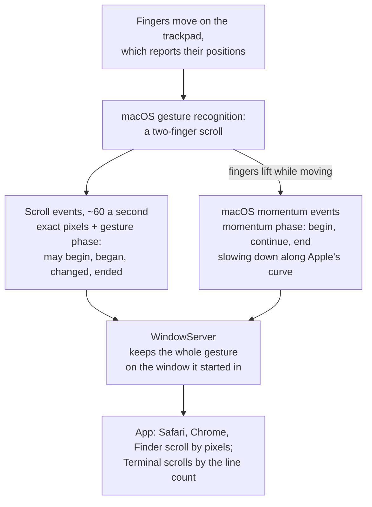

What makes it feel the way it does:

- **It moves with your fingers.** Each event carries the exact distance your
  fingers moved since the last one (a few pixels), so the page tracks your
  hand continuously. There are no steps.
- **It tells the app what is happening.** Every event has a *phase*: the
  fingers touched (may begin), started moving (began), keep moving
  (changed), lifted (ended). Apps use this for rubber-banding at the edges and
  to know when a scroll is over.
- **It keeps going after you let go.** When your fingers lift while moving,
  macOS itself keeps sending events, marked *momentum*, that slow down along
  a fixed curve. A new touch stops them at once.
- **It stays with one window.** The whole gesture goes to the window it
  started in, even if the pointer drifts onto another window.
- **It also counts lines.** Each event carries a line count too, about one
  line per 14 px scrolled, for apps that scroll by lines. Terminal, for
  example, ignores pixels entirely.

Here is a real flick, recorded event by event:

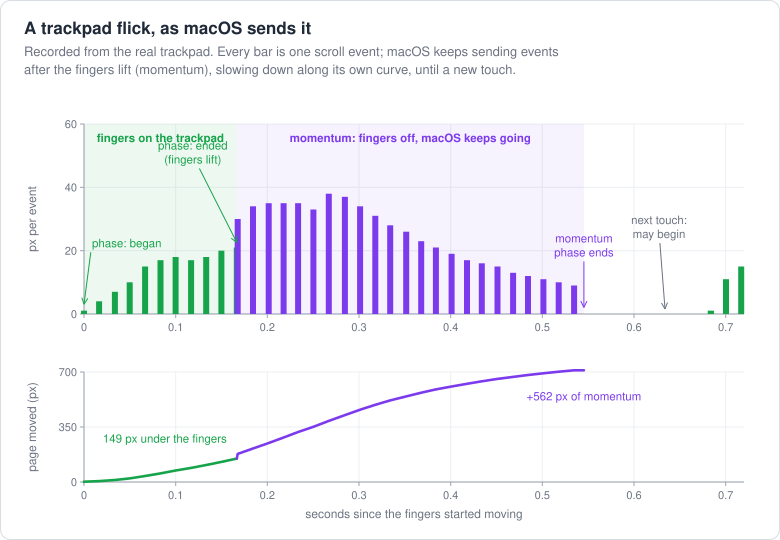

The fingers moved the page 149 px. macOS's momentum added another 562 px after
they lifted, slowing down along its curve. That curve matters later, because
mousemap reuses it:

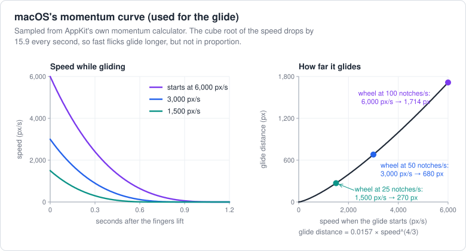

The curve was sampled from AppKit's own momentum calculator
(`_NSScrollingMomentumCalculator`). The cube root of the speed falls in a
straight line, by 15.9 every second. So a glide from speed $v_0$ (px/s) lasts
$3\,v_0^{1/3}/47.7$ seconds and covers

```math
D = \frac{3}{4 \cdot 47.7}\, v_0^{4/3} \approx 0.0157\, v_0^{4/3}\ \text{px}
```

For example, a flick at 1,500 px/s glides 270 px in 0.72 s, and one at
6,000 px/s glides 1,714 px in 1.14 s.

## 2. How a mouse wheel scroll works, and what goes wrong

A mouse wheel has notches (detents). The mouse reports only "one notch this
way" or "one notch that way", and macOS turns each report into one scroll
event:

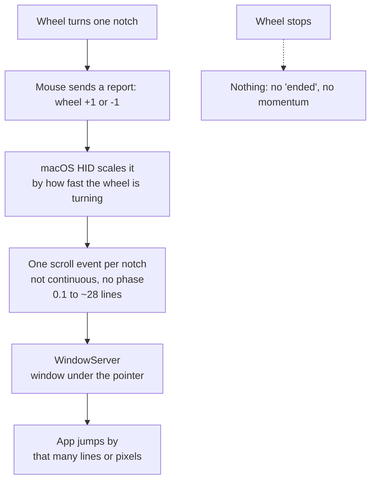

This is what the Logitech M650 actually sends, recorded at the lowest level
software can see (two quick flicks):

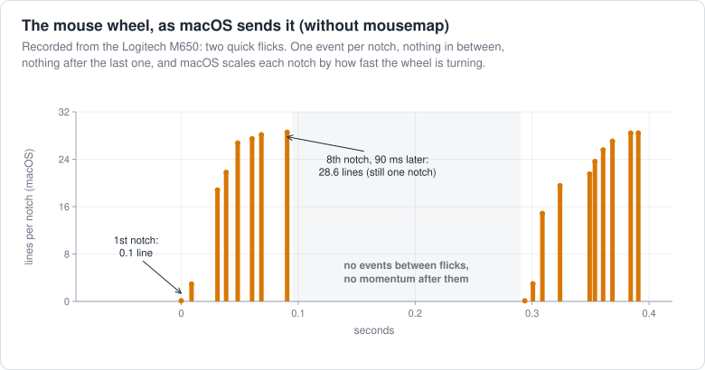

Compare it with the trackpad flick above. Every difference is a problem:

| What you notice | Why | How mousemap deals with it |
|---|---|---|
| Scrolling jumps in steps | One event per notch, nothing in between | Turns each notch into a smooth stream of small pixel events ([4.3](#43-the-scroll-engine-the-wheel-as-a-finger)) |
| No glide after a fast spin | The wheel sends nothing after the last notch; there is no momentum | Glides on along macOS's own momentum curve ([4.3](#43-the-scroll-engine-the-wheel-as-a-finger)) |
| Distances are unpredictable | macOS scales a notch from 0.1 line to 28 lines by speed | Ignores that scaling: every notch is the same 60 px, like a finger moving the same distance ([4.3](#43-the-scroll-engine-the-wheel-as-a-finger)) |
| Mouse and trackpad can't scroll opposite ways | macOS has one "natural scrolling" switch for both | Flips the wheel only (`scroll_reverse`) ([4.5](#45-reversing-the-wheel-only)) |
| Side buttons only work in a few apps (browsers) | They are plain buttons 3 and 4 | Turns them into shortcuts, media keys or commands ([4.2](#42-buttons)) |

Making smooth events for a wheel then brings three problems of its own, which
mousemap also has to handle:

| Problem | Why | Fix |
|---|---|---|
| Terminal scrolled 7 times too far | A synthetic scroll event says "1 line" however few pixels it carries, and Terminal scrolls by lines | Report a line per ~14 px, like the trackpad ([4.4](#44-posting-scroll-events)) |
| iPhone Mirroring stood still, then jumped | The phone animates every wheel event; 120 a second kept restarting the animation | 15 bigger events a second there ([4.6](#46-iphone-mirroring)) |
| Moving to another window scrolled that one too | Each event goes to the window under the pointer when it is sent | Stop the glide when the pointer leaves the window ([4.7](#47-staying-with-one-window)) |

And some limits of the wheel itself can't be fixed at all
([section 5](#5-the-wheels-own-limits)).

## 3. High-level design

mousemap is a single Swift program with two roles: a **command-line tool**
(`mousemap on`, `set`, `status`, ...) and a **background agent**
(`mousemap run`) that launchd keeps running. The agent puts an *event tap* into
the macOS event stream. Every scroll and extra-button event passes through it
before any app sees it, and the tap can let an event through, change it,
swallow it, or post new events of its own.

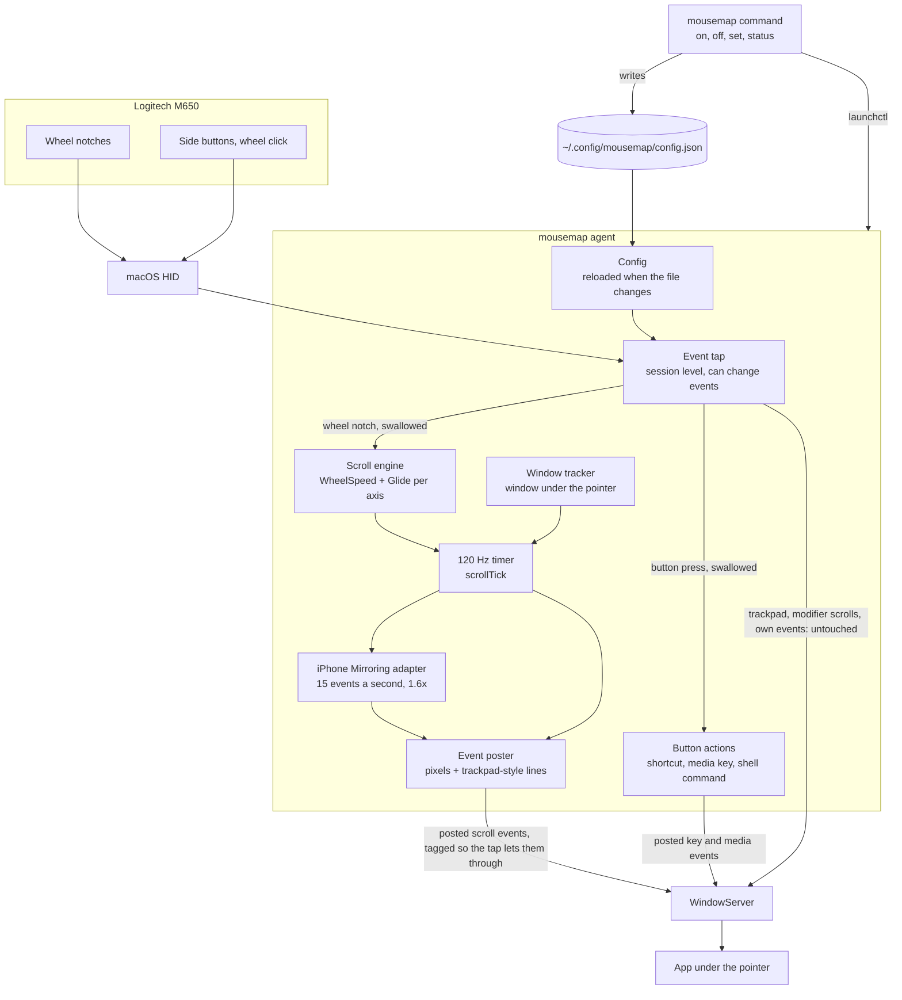

The parts and what each one owns:

| Part | Job | In the code |
|---|---|---|
| Event tap | Sees every scroll, extra-button press and release; decides what happens to each | `installTap`, `handle` |
| Config | Reads `config.json` (comments allowed), per-app overrides, reloads when it changes | `Config`, `parseConfig`, `reloadConfigIfChanged` |
| Button actions | Posts shortcuts with the right key flags, media keys, runs shell commands | `Action`, `parseAction`, `perform` |
| Scroll engine | Turns notches into page movement: following the wheel, then gliding | `WheelSpeed`, `Glide`, `addScroll` |
| Timer | 120 times a second: advances the glide and posts the pixels | `scrollTick` |
| Event poster | Builds each scroll event: pixels, line counts, "continuous", our tag | `postScroll` |
| Window tracker | Which window is under the pointer, and which app owns it | `windowUnder`, `app(owning:)`, `pointerLeftScrollWindow` |
| iPhone Mirroring adapter | Fewer, bigger events while scrolling iPhone Mirroring | in `scrollTick` |
| Command line | `on`/`off` (launchd), `set`/`unset`/`show`/`edit`, `status`, `apps` | `turnOn`, `changeSetting`, ... |
| install.sh | Build, sign with a stable local certificate, install, start | `install.sh` |

Design principles:

- **Copy macOS rather than invent.** "Like a trackpad" means Apple's own
  numbers: its momentum curve, and how many lines its trackpad reports per
  pixel.
- **Touch only the mouse wheel.** Continuous scroll events (trackpads, Magic
  Mouse) and anything mousemap posted itself go straight through.
- **Change nothing it doesn't have to.** Buttons without an action, scrolling
  with a modifier held, and apps without settings behave exactly as without
  mousemap.
- **One file, no dependencies, no kernel extension.** Only public CoreGraphics
  and AppKit APIs.

## 4. Low-level design

### 4.1 The event tap

The tap is created at the **session** level, at the head of the queue, as an
active (not listen-only) tap. It asks only for the events it needs:
`otherMouseDown`, `otherMouseUp` (buttons 2 and up) and `scrollWheel`. Left
and right clicks and pointer movement never reach it. It runs on the main run
loop, so the tap callback, the scroll timer and config reloads never run at the
same time and need no locking.

Every event goes through `handle`.

Scroll events:

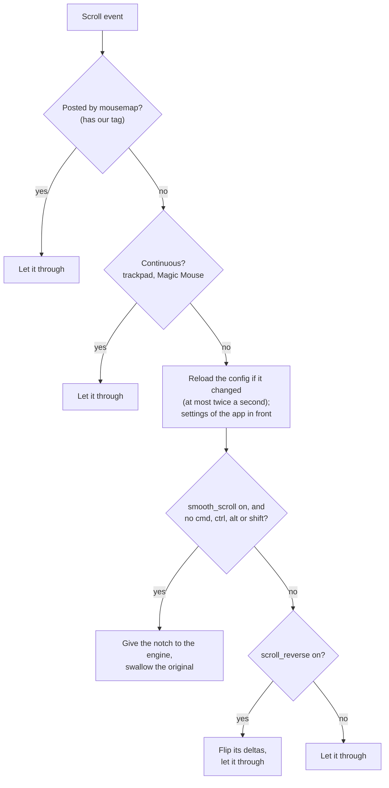

Extra buttons (2 = wheel click, 3 = back, 4 = forward):

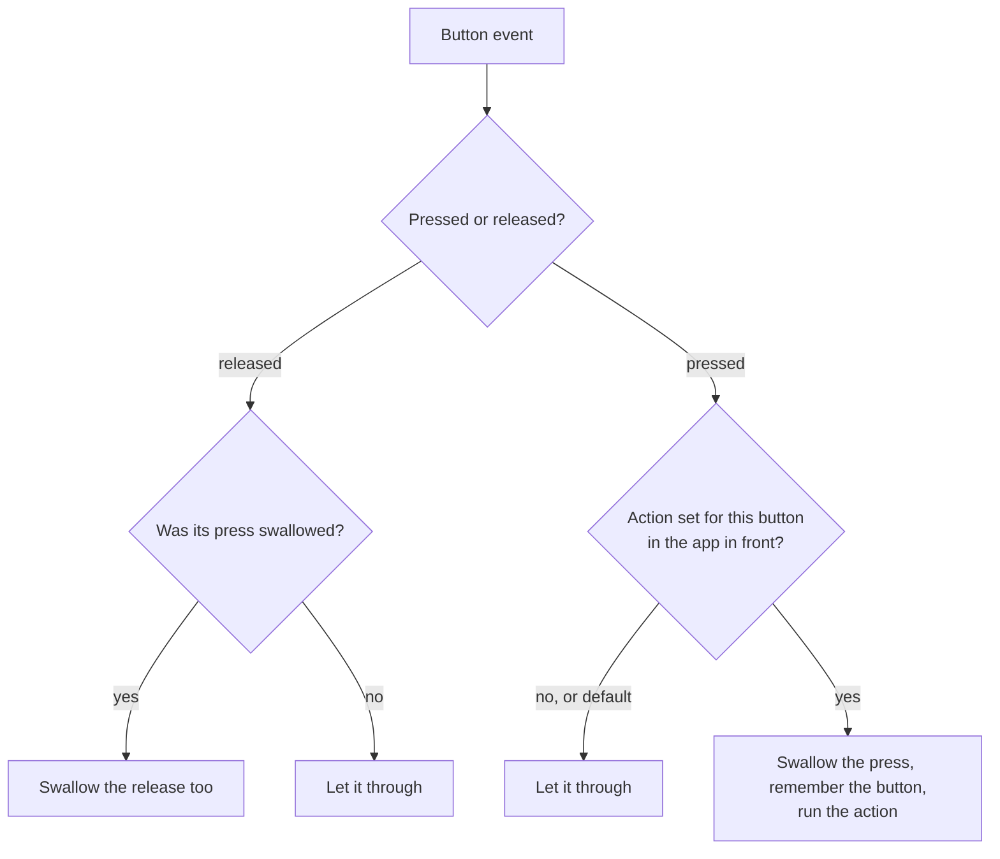

If macOS ever switches the tap off (it does when a callback takes too long),
the tap receives a "tap disabled" event and switches itself back on.

Details that matter:

- **Our own events.** mousemap posts its scroll events into the same stream,
  so they come past the tap again. Each one carries a tag in its user-data
  field (`0x6D6D6170`, "mmap"), and the tap lets tagged events straight
  through.
- **Trackpads are recognised** by the "continuous" flag that macOS sets on
  their events. A mouse wheel's events don't have it.
- **Per-app settings** are looked up by the bundle ID of the app in front
  (`NSWorkspace.frontmostApplication`). That is the app with keyboard focus,
  which isn't always the window under the pointer.

### 4.2 Buttons

The M650's side buttons arrive as `otherMouseDown` / `otherMouseUp` with button
numbers 3 (back) and 4 (forward); the wheel click is 2. If an action is
configured for the button in the app in front, the press is swallowed, the
button is remembered, and the action runs. When the release comes, it is
swallowed too, so apps never see half a click.

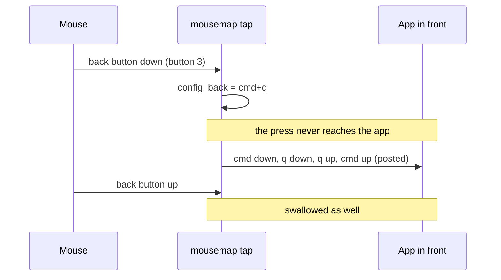

Actions (`Action`):

| Config | What is posted |
|---|---|
| `cmd+c`, `ctrl+left`, `f11`, ... | Key events like a real keyboard: each modifier pressed in order, the key down and up, modifiers released in reverse. Arrow keys get the `fn` and keypad flags and F/navigation keys the `fn` flag, as a real keyboard sends them; some shortcuts (like `ctrl+arrow` to switch desktops) are ignored without them. |
| `media:play_pause`, `media:volume_up`, ... | A system-defined event (subtype 8) with the media key code, down then up, the way media keys arrive. |
| `shell:open -a Safari` | Runs the command with `/bin/sh -c`. |
| `none` | Swallows the button. |
| `default` | Lets the button through (useful to undo a global action in one app). |

Key names are positions on a US layout (virtual key codes). `fn` has no key
press of its own, only its flag, because pressing it alone can open the emoji
picker.

### 4.3 The scroll engine: the wheel as a finger

The idea: **treat the wheel like a finger on a trackpad.** Each notch is the
finger moving 60 px. The page follows the "finger" one to one, smoothly, and
when the wheel stops after turning fast, the page glides on the way a trackpad
flick does, along macOS's own momentum curve. Every notch moves the page the
same distance however fast the wheel turns, so turning it back the same number
of notches brings the page back.

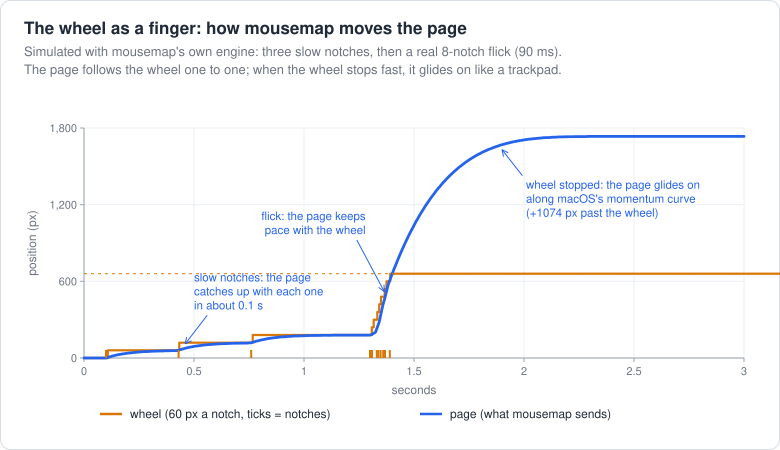

#### Data model

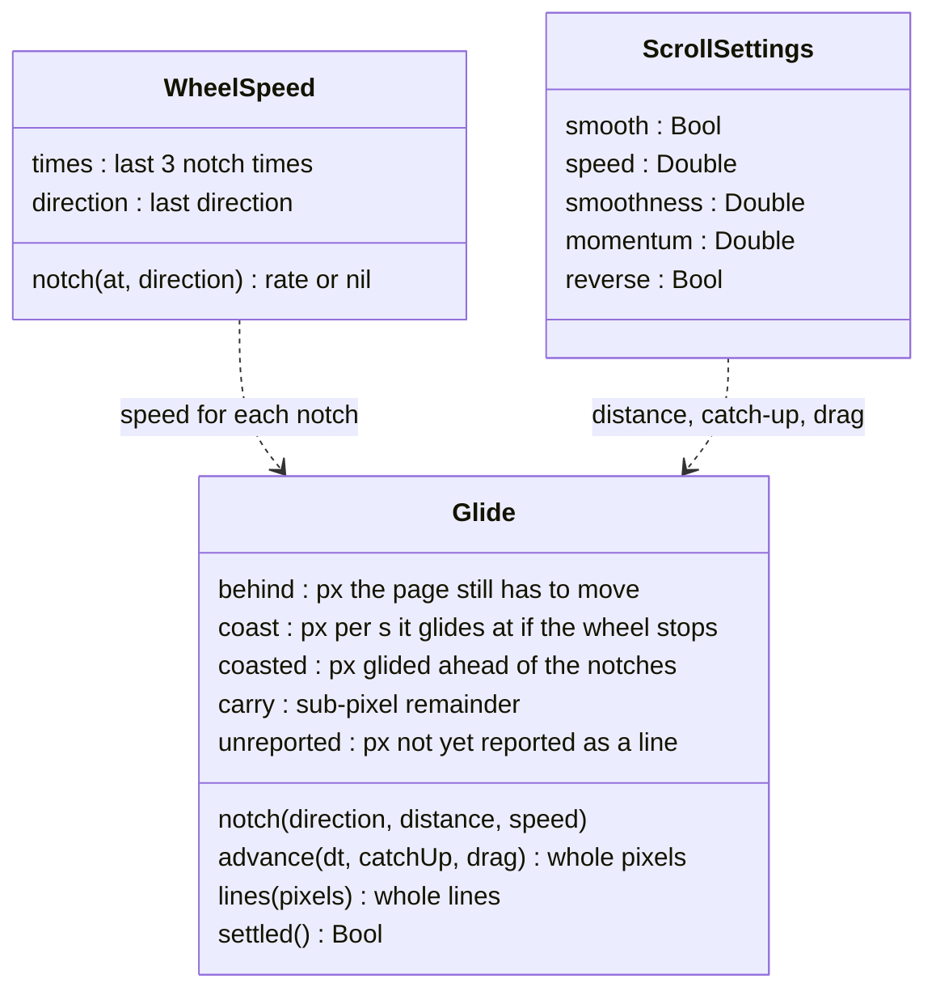

There is one `WheelSpeed` and one `Glide` per axis (vertical and horizontal),
plus a 120 Hz timer that runs only while something is moving.

#### Constants

| Name | Value | Meaning |
|---|---|---|
| `notchDistance` | 60 px | how far one notch moves the page (× `scroll_speed`) |
| `followSeconds` | 0.1 s | time constant of the page catching up (× `scroll_smoothness`) |
| `momentumDrag` | 47.7 | macOS momentum: the cube root of the speed drops by 47.7/3 a second (÷ `scroll_momentum`) |
| `notchWindow` | 0.2 s | a longer pause between notches starts a new movement |
| `minNotchGap` | 8 ms | closer notches (bunched-up Bluetooth reports) count as this far apart |
| `maxSpeed` | 15,000 px/s | speed limit |
| `pixelsPerLine` | 14 px | the trackpad reports a whole line every ~14 px (measured) |
| `fixedPerLine` | 0.8 | ... and 0.8 per line in the fractional line field (measured) |
| `mirroringTicks` | 8 | timer ticks per event to iPhone Mirroring (15 a second) |
| `mirroringScale` | 1.6 | iPhone Mirroring moves 0.62 pt per px sent |

#### When a notch arrives (`addScroll`)

**1. Direction only.** The notch is read as +1 or −1 from its line delta (or
the fractional delta if the line delta is 0). macOS's own scaling (0.1 to 28
lines) is ignored on purpose.

**2. How fast is the wheel turning?** `WheelSpeed` keeps the last three notch
times of the current movement. A new direction, or a pause longer than
`notchWindow`, starts over. With three notches:

```math
\text{rate} = \frac{2}{\max(t_n - t_{n-2},\ 0.016\ \text{s})}\ \text{notches/s}
```

Two gaps, not one, because Bluetooth delivers notches unevenly (gaps of 0, 7,
8 and 15 ms in a row are normal); one gap alone swings wildly. The wheel's
speed is then

```math
v = \min(15000,\ \text{rate} \times 60\ \text{px} \times \text{speed})
```

or 0 when `scroll_momentum` is 0. With fewer than three notches the speed is
unknown.

**3. Move the "finger".** `Glide.notch`:

- **Turning back** (the notch is against the current movement) stops the old
  movement: the glide is reset, like a finger landing on a trackpad stops its
  momentum.
- **Speed unknown** (first notches of a movement, or slow turning): the page
  has 60 px more to go: `behind += 60`.
- **Speed known** (the wheel is turning fast): the page should glide at the
  wheel's speed: `coast = v`. Any distance it already glided ahead of the
  wheel *counts toward this notch* ("covered"), so a fast spin doesn't add the
  glide on top of every notch: `covered = min(coasted, 60)`,
  `behind += 60 − covered`, `coasted −= covered`.

**4. Start the timer** if it isn't running, and remember the window under the
pointer ([4.7](#47-staying-with-one-window)) and whether it belongs to iPhone
Mirroring ([4.6](#46-iphone-mirroring)).

#### Every tick (`scrollTick`, 120 times a second)

For each axis, `Glide.advance(dt)` does four things.

**1. Glide.** If `coast` isn't 0, the speed decays along Apple's curve and the
distance travelled this tick is the exact integral, with
$k = 47.7 / \text{momentum}$:

```math
v^{1/3}_{\text{to}} = \max\left(0,\ v^{1/3}_{\text{from}} - \frac{k\,\Delta t}{3}\right)
```

```math
\Delta x_{\text{glide}} = \frac{3}{4k}\left(v_{\text{from}}^{4/3} - v_{\text{to}}^{4/3}\right)
```

**2. Catch up.** The page closes a fixed share of the distance it is behind,
with $\tau = 0.1\ \text{s} \times \text{smoothness}$:

```math
\Delta x_{\text{follow}} = \text{behind} \cdot \left(1 - e^{-\Delta t/\tau}\right)
```

While gliding, $\tau$ is doubled: the page already moves with the wheel, and
catching up gently stops a fast spin from starting with a surge.

**3. Whole pixels.** The sum is rounded to whole pixels; the fraction carries
over to the next tick, so nothing is lost.

**4. Settled** when there is no glide and less than a pixel left: the timer
stops and the state is cleared.

Using an exponential catch-up and integrating the glide exactly means the
result doesn't depend on timer jitter: a late tick just moves a bit further.

#### The life of a glide

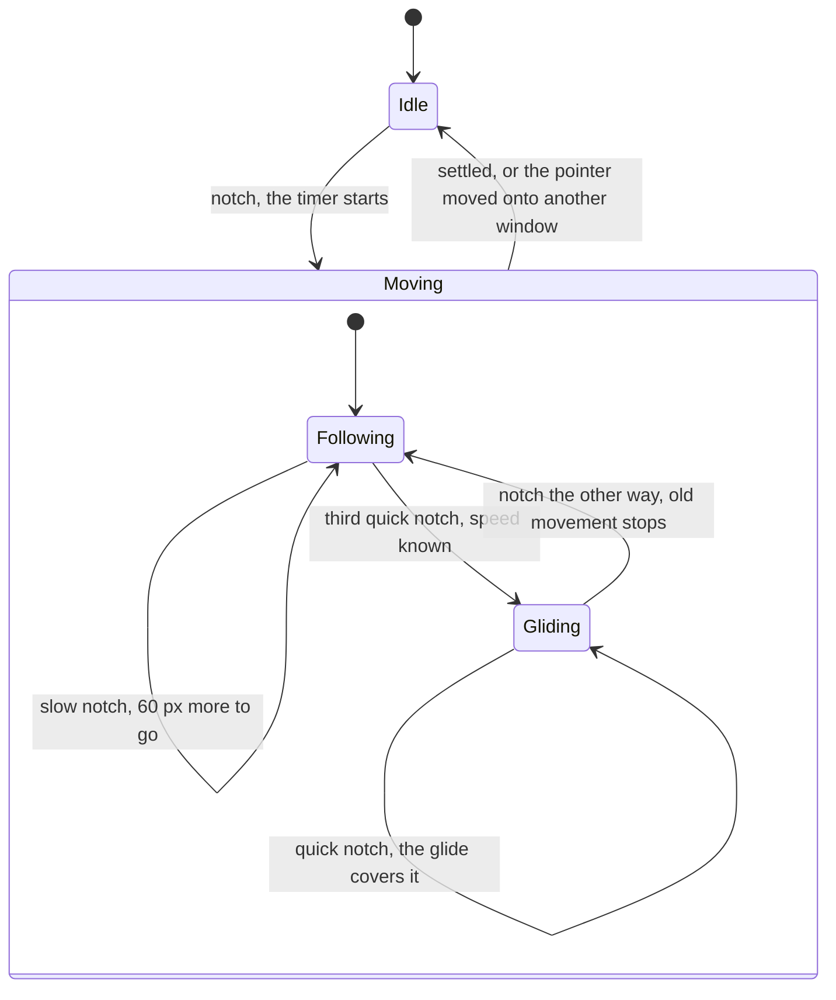

(Simplified: following and gliding can overlap, since while gliding the page
can still be catching up a little. "Settled" means no glide and less than a
pixel left.)

#### From one notch to pixels on screen

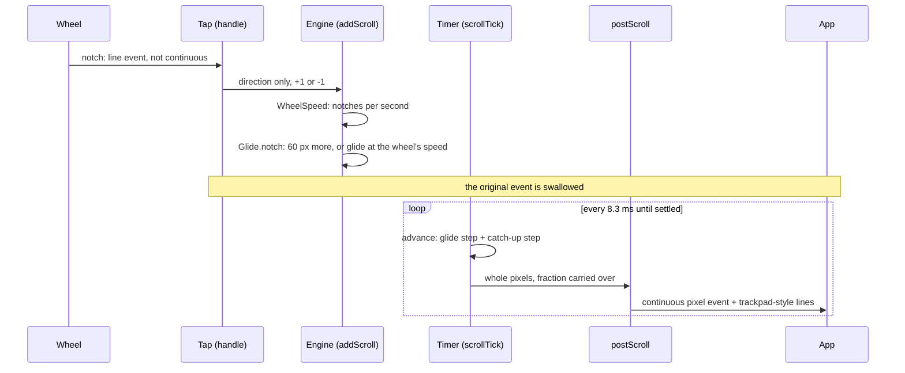

#### Why the engine looks like this

The first version worked differently: every notch added speed, fast notches
were boosted, and friction slowed the page down. It felt lively but was
unpredictable. 20 notches turned fast scrolled up to **11 times as far** as
the same 20 notches turned slowly. The current engine moves the wheel's
distance plus a trackpad-style glide, within 1% of that target at every
speed:

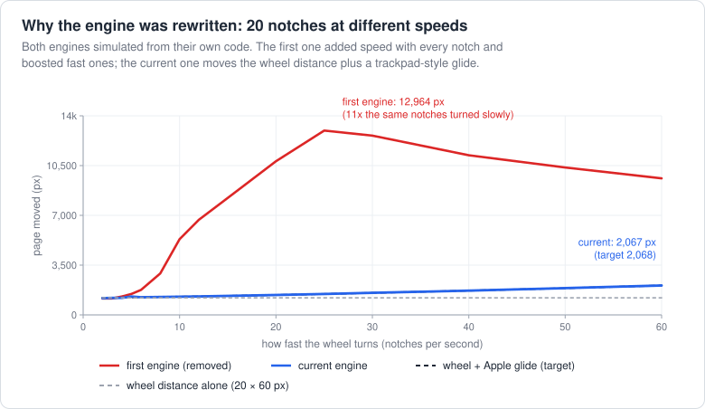

### 4.4 Posting scroll events

Each tick's pixels go out as one new scroll event (`postScroll`):

| Field | Value | Why |
|---|---|---|
| units | pixels | precise scrolling, like a trackpad |
| point delta (axis 1 / 2) | the tick's whole pixels, vertical / horizontal | what Safari, Chrome, Finder scroll by |
| line delta | whole lines, one per 14 px scrolled (remainder carried) | what Terminal scrolls by |
| fractional line delta | 0.8 × lines | matches what the trackpad sends |
| continuous | 1 | marks it as precise scrolling, like a trackpad's, so apps scroll by the exact pixels |
| user data | `0x6D6D6170` | our tag, so the tap lets it through |

It is posted at the HID level, so it travels through the rest of the event
system like real input and goes to the window under the pointer.

**Why lines matter.** `CGEvent` fills in the line field on every pixel event,
and puts at least 1 line there however small the event is. Terminal scrolls
only by that count, so mousemap's 120 events a second scrolled it 7 times too
far, and Terminal needed its own `scroll_speed 0.25`. Recording the real
trackpad showed it reports a whole line about every 14 px. mousemap now does
the same, and Terminal scrolls exactly like with the trackpad. Pixel-based apps
are unaffected.

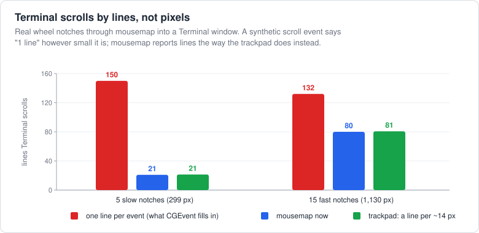

### 4.5 Reversing the wheel only

macOS's "natural scrolling" applies to mouse and trackpad together. mousemap
flips only the wheel:

- With smooth scrolling, the direction is flipped when the notch enters the
  engine.
- Without it (or with a modifier held), the event's line, fractional and pixel
  deltas are negated in place. The line delta is set first, because setting it
  makes macOS recalculate the other two.

So keep Natural scrolling on for the trackpad, and set `scroll_reverse` to
`true` if you want the wheel the other way.

**Modifiers.** With cmd, ctrl, alt or shift held, the original event goes
through unsmoothed (only reversed if asked), so cmd+scroll zoom and
shift+scroll sideways behave the way apps expect.

### 4.6 iPhone Mirroring

iPhone Mirroring (`com.apple.ScreenContinuity`) forwards Mac input to the phone
by **the device it came from**, looked up through the event's sender ID (its
frameworks show `lookUpServiceInfo(for senderID:)` and a "basic mouse"
service). Trackpad events go over as touches, and the phone scrolls under your
fingers. mousemap's events have no device behind them, so they go over as
plain mouse-wheel input, and **the phone animates each wheel event**. At 120
events a second each one restarted that animation: the feed stood still while
the wheel turned, then jumped when it stopped.

Filming the iPhone Mirroring window and replaying mousemap's movement at
different rates gave:

| Events per second | What the phone did |
|---|---|
| 60 or more | froze, then jumped |
| 30 | followed, but choppy |
| **15** | **as smooth as the real trackpad** (about a quarter of frames still, speed changes about the size of the mean speed) |
| 12 | started to speed up big steps |
| 10 | choppy |

The phone also moves 0.62 points per pixel sent, so mousemap scales by 1.6
there to move as far on screen as in Mac apps.

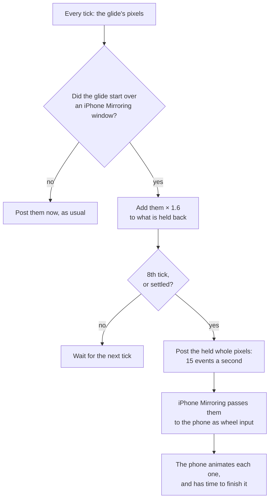

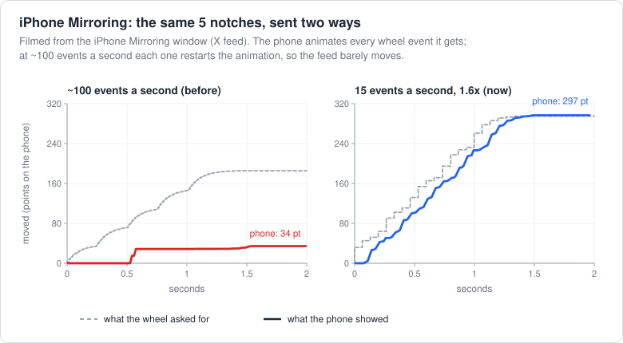

Result: 5 slow notches move the phone 298 pt (299 px in Mac apps; it was 16
to 34 pt before), and a fast spin moves about 950 pt following live (before:
282 pt, after standing still for 1.2 s). Other apps get exactly the same
events as before; the check is the window under the pointer when the glide
starts.

What didn't work: copying the trackpad's sender ID onto mousemap's events (the
phone dropped them), and adding fake gesture phases (no live following).

### 4.7 Staying with one window

A trackpad gesture stays with the window it started in. mousemap's events
can't: each posted event goes to the window under the pointer **at the moment
it is posted**. The glide keeps posting for a while after the wheel stops
(about 0.4 s of catch-up after slow notches, a second or two after a fast
spin), so scrolling one window and moving straight to another scrolled that
one too.

mousemap remembers the window under the pointer when a glide starts
(`NSWindow.windowNumber(at:belowWindowWithWindowNumber:)`, the window a click
would hit, for any app). On every tick and every notch, if the pointer has
moved, it checks again (about 0.2 ms), and if the pointer is over a different
window, the glide stops.

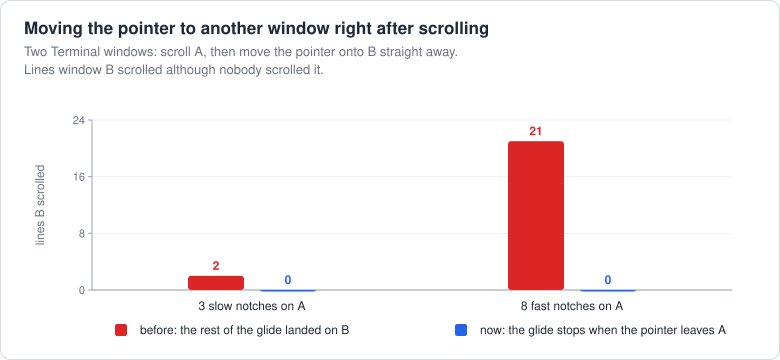

While the pointer stays on the window, nothing changes (A still scrolled 12
and 59 lines in the same test).

What didn't work for sending the rest of the glide to the old window: setting
the event's location (it goes there, but moves the pointer back), posting at
the annotated session level (nothing scrolled), the window number fields
(ignored), and posting to the app directly (`postToPid`, which Terminal
ignores). The trackpad's own gesture phases would latch to the window, but
they change how apps treat the events.

### 4.8 Config and commands

The config is a JSON file with comments and trailing commas allowed (JSON5).
Smart quotes are turned back into plain ones (TextEdit likes to add them).
Global settings apply everywhere; `apps` holds overrides by bundle ID, and an
app's scroll settings start from the global ones.

```json5
{
  "smooth_scroll": true,
  "scroll_reverse": true,
  "back": "cmd+q",
  "forward": "ctrl+up",
  "apps": {
    "com.apple.Preview": { "scroll_speed": 0.5 },
    "com.google.Chrome": { "back": "default" },
  },
}
```

Changing a setting from the command line, and the agent picking it up:

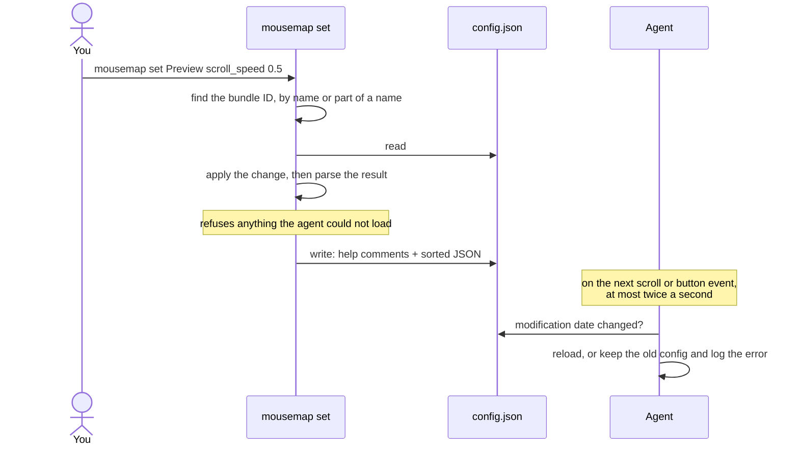

Values are checked strictly: booleans must be `true`/`false` (JSON's 0 and 1
are refused), numbers must be above 0 (`scroll_momentum` may be 0), unknown
settings and keys are errors.

### 4.9 Running in the background

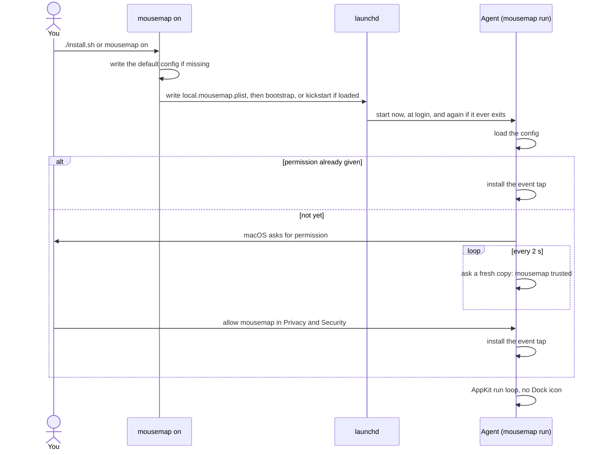

- **launchd agent** `~/Library/LaunchAgents/local.mousemap.plist`:
  `RunAtLoad`, `KeepAlive`, `ProcessType Interactive`, output to
  `~/Library/Logs/mousemap.log`. `mousemap off` disables and unloads it.
- **Permission.** The event tap needs the Accessibility permission (Device
  Control and Data Access on macOS 27). A running process can keep seeing the
  old answer after you grant it, so the agent asks a fresh copy of itself
  (`mousemap trusted`) every 2 s.
- **Signing.** macOS ties the permission to the code signature. An ad-hoc
  signature changes with every build, so install.sh creates a self-signed
  certificate once (in its own keychain in `.signing/`) and signs every build
  with it; the permission survives rebuilds.
- **Install** copies the new binary next to the old one and renames it over,
  so a running copy is never overwritten in place.
- **The run loop** is AppKit's (`NSApplication`, no Dock icon), which keeps
  the "app in front" information current.

## 5. The wheel's own limits

These were found by recording the mouse at the lowest level software can see
(a listen-only tap at the HID level, before mousemap's tap) while doing the
same things with the mouse and the trackpad. They are properties of the wheel,
not of mousemap. The first one happens the same with mousemap turned off.


1. **Fast rubbing reports one direction.** Rubbing the wheel up and down as
   fast as on a trackpad produced bursts of notches all one way, with silent
   gaps where the strokes back should be (92 in a row in one recording, 267
   against 14 in another). The page runs off one way, or on a short page sits
   at the end and looks like it isn't scrolling. A little slower, and the
   wheel reports both ways; mousemap then moves the page back and forth with
   every stroke.
2. **A grab sends nothing.** Spun fast, the M650's wheel spins freely (dozens
   of notches in a row, up to 71, at about 90 a second). Grabbing it to turn
   back produces no event at all; the first sign is the first notch the other
   way, 0.26 to 0.31 s later in the recordings. Until then the glide carries
   on (940 to 1,600 px). The moment that notch arrives, mousemap stops the old
   movement and turns the page.
3. **A grab can't be told from a normal stop.** A free spin that stops by
   itself also stops dead at full speed, so the notch timing looks the same
   either way.

Two fixes were tried and removed, because they changed normal scrolling,
which matters more:

- **Keeping every notch through quick turns** (so going up and down the same
  number of notches ends exactly where it started, and no glide while going
  back and forth). In synthetic tests it came back to the exact line. With
  the real wheel, the page jumped back at each turn by however far it had
  glided, and flicks after a turn stopped and started.
- **Stopping the glide when a free spin stops dead** (taking it for a grab).
  It cut the overshoot after a grab from 940–1,600 px to 250–380 px, but
  normal fast scrolling stops dead too, so every glide was cut short.

## 6. Design decisions and what was tried

| Question | Chosen | Also tried, and why not |
|---|---|---|
| How far does a notch go? | Always 60 px, direction only | macOS's scaled value (0.1–28 lines): unpredictable. Speed boost per notch (first engine): up to 11x too far. |
| How does the page move? | Exponential catch-up to the wheel, τ = 0.1 s | Speed kick + friction (first engine): distance depended on speed. |
| What happens when the wheel stops fast? | Glide along macOS's momentum curve, sampled from AppKit | The first engine's friction, tuned by feel: glides grew far too long at speed. |
| How is the wheel's speed measured? | Last two gaps, gaps under 8 ms counted as 8 ms | One gap: Bluetooth bunching makes it swing wildly. |
| How to keep a fast spin from surging? | Glide distance counts toward later notches; gentler catch-up while gliding | |
| What tells apps about lines? | A line per ~14 px, 0.8 fractional, like the trackpad | CGEvent's default (1 line per event): Terminal 7x too fast. |
| How to tag our own events? | User-data field `0x6D6D6170` | |
| iPhone Mirroring | 15 events a second, 1.6x | Trackpad's sender ID (dropped by the phone); fake gesture phases (no live following); 30/s (choppy), 60+/s (froze). |
| Glide when the pointer leaves the window | Stop | Send to the old window: moves the pointer back, or is ignored. Gesture phases: change how apps treat the events. |
| Turning back mid-glide | Stop the old movement, like a finger landing | Keep every notch through quick turns: jumps back and stop-and-go flicks (removed). |
| A free spin that stops dead | Glide on as usual | Treat it as a grab and stop: cut every normal glide (removed). |
| Per-app settings | App in front | Window under the pointer would be closer to the trackpad; with no per-app scroll settings it doesn't matter. |
| Keep the permission across rebuilds | Self-signed local certificate | Ad-hoc signing: permission lost on every build. |

## 7. How it was measured

Every number here comes from one of these:

- **Event recorders.** Listen-only event taps write down every scroll event
  with all its fields: one at the HID level (the raw wheel, before mousemap
  sees it) and one at the end of the session level (exactly what apps
  receive, from the trackpad or from mousemap). Comparing the real trackpad
  field by field with mousemap's events found the line problem.
- **Terminal test.** A throwaway Terminal window full of numbers; real-looking
  wheel notches are posted so they pass through the running mousemap, and
  Terminal's scroll position is read from its scroll bar through
  Accessibility. The two-window version measures what leaks into a second
  window.
- **Filming.** ScreenCaptureKit films a window at 60 frames a second and the
  vertical shift between frames is found by image alignment, giving how far
  the content really moved, frame by frame (used for iPhone Mirroring and
  Chrome).
- **AppKit's momentum calculator**, sampled directly, for the glide curve.
- **Replays.** Recorded notch timings are replayed tick by tick through the
  engine compiled straight from `mousemap.swift` (old and new versions side by
  side), so a change can be checked against real hand movement before it is
  installed. A change only ships if everything outside its target comes out
  identical, tick by tick.

## 8. Numbers at a glance

| Measurement | Before | Now |
|---|---|---|
| 20 notches at 25 a second | 12,964 px (first engine) | 1,469 px (target 1,470) |
| 5 slow notches in Terminal | 150 lines reported (1 per event) | 21 lines, like the trackpad |
| 15 fast notches in Terminal | 132 lines reported | 80 lines (trackpad rule: 81) |
| 5 slow notches in iPhone Mirroring | 16–34 pt, after a pause | 298 pt, following the wheel |
| Fast spin in iPhone Mirroring | 282 pt, frozen 1.2 s first | ~950 pt, following live |
| Second window after scrolling the first | 2 and 21 lines | 0 and 0 |
| One slow notch | 58 px (first engine) | 59 px |
| Trackpad flick (for comparison) | 149 px under the fingers | + 562 px of momentum |

## 9. Code map

Everything is in `mousemap.swift`, in this order:

| Section | Contents |
|---|---|
| Actions | `Action`, modifier and key-code tables, media keys, `parseAction` |
| Config | `ScrollSettings`, `Config`, `parseScroll`, `parseButtons`, `parseConfig`, the default config with its help text |
| Performing actions | `postShortcut` (with real-keyboard flags), `postMediaKey`, `perform` |
| Smooth scrolling | constants, `WheelSpeed`, `Glide`, `windowUnder`, `app(owning:)`, `pointerLeftScrollWindow`, `stopScroll`, `addScroll`, `reverseScroll`, `scrollTick`, `postScroll` |
| Agent | `log`, `reloadConfigIfChanged`, `handle`, `installTap`, `isTrustedNow`, `runAgent` |
| Commands | `launchctl`, `turnOn`, `turnOff`, `status`, `edit`, `listApps`, `bundleID`, `changeSetting`, `showSettings`, the command switch |

## License

MIT, see [LICENSE](LICENSE).
